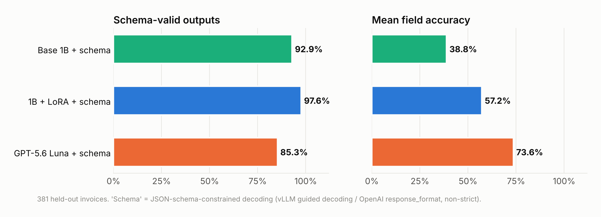
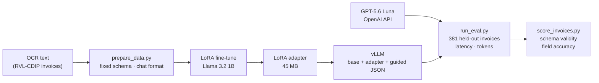
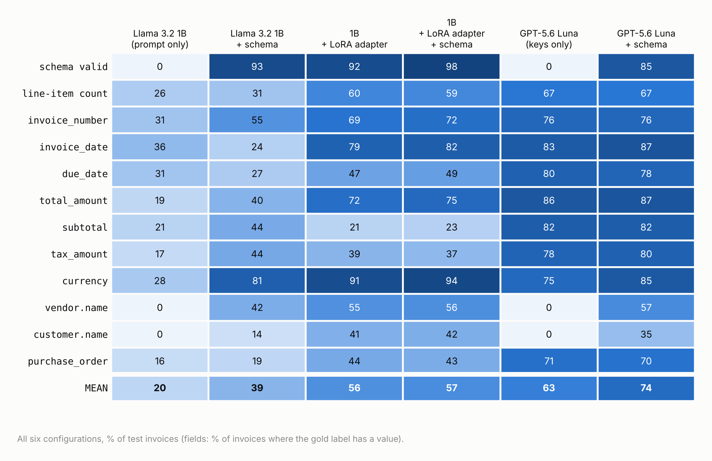
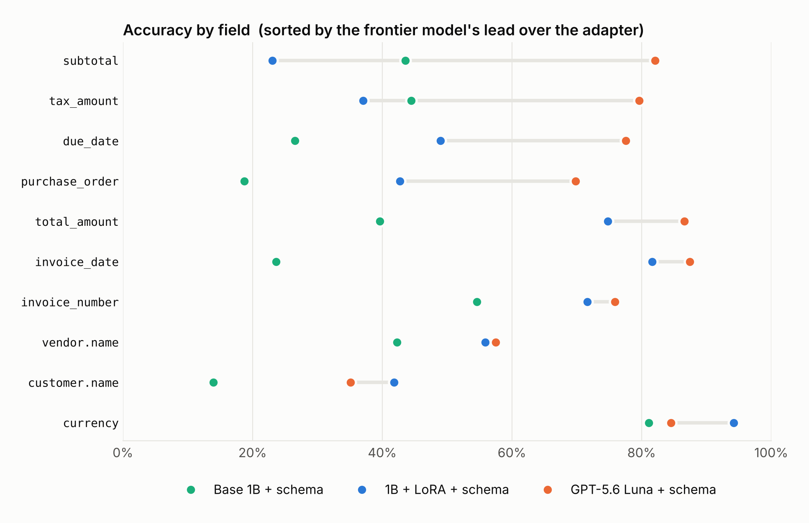
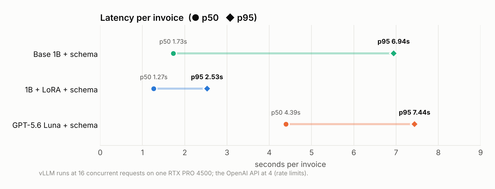
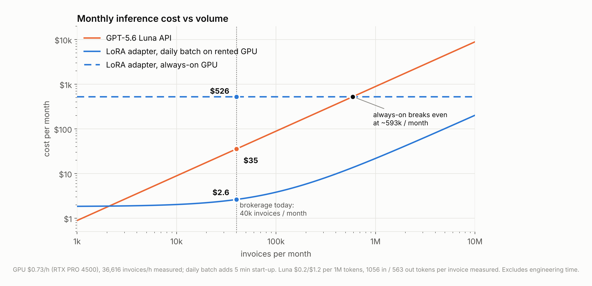

<div align="center">

# Invoice LoRA vs Frontier

**Can a small fine-tuned model replace a frontier model for structured invoice extraction?**

LoRA fine-tune of Llama 3.2 1B · served with vLLM · benchmarked against GPT-5.6 Luna on the same held-out set


</div>

---

## The question

A freight brokerage processes **40,000 carrier invoices a month** across hundreds of layouts.
A frontier model extracts them well, but costs more than the clerks it replaced, and schema
violations still break the accounting import twice a week.

**Can a small, fine-tuned model hold a strict schema at a fraction of the cost?**

To answer it, every configuration is judged on the same four numbers, on the same 381 invoices
that never touched training:

| Ship-gate metric | Why it matters |
|---|---|
| **Schema validity** | An output either passes the strict JSON Schema or breaks the import |
| **Field-level accuracy** | Right invoice number, dates, totals, tax, parties |
| **Cost per 1,000 invoices** | The reason to consider a small model at all |
| **p95 latency** | What the slowest 1 in 20 invoices waits |

## Result at a glance



| | Base 1B + schema | **1B + LoRA + schema** | **GPT-5.6 Luna + schema** |
|---|---:|---:|---:|
| Schema-valid outputs | 92.9% | **97.6%** | 85.3% |
| Mean field accuracy | 38.8% | 57.2% | **73.6%** |
| p95 latency | 6.94 s | **2.53 s** | 7.44 s |
| Cost per 1,000 invoices | $0.03 | **$0.02** | $0.89 |
| Cost at 40k invoices / month | — | **$2.6** batched · $526 always-on | $35 |

### Recommendation: ship the prompt

**Use GPT-5.6 Luna with schema-constrained output, validate every response against the schema,
and route the rare failure to a retry or a human.** At 40,000 invoices a month it costs about
**$35**: cost does not decide this decision, accuracy does, and the frontier model is
**16 points ahead** on mean field accuracy, with its largest leads on the fields accounting cares
about most (subtotal, tax, due date, total).

The fine-tune is still a clear win **over prompting the same small model**: +18 points field
accuracy, 1.7× fewer output tokens, 1.5× the throughput and a 2.7× lower p95. It becomes the right
choice if any of these change:

- **Volume** grows past ~600k invoices a month (an always-on GPU then beats the API), or the work can be batched.
- **Latency** matters: the use case becomes interactive (adapter p95 2.5 s vs 7.4 s).
- **Control**: documents must not leave the company's infrastructure.

> All headline numbers are evaluation results on held-out data. Training loss is reported only
> in the training section, as a sanity check.

---

## How it works



Six configurations were run through the identical pipeline, the same system prompt and the same
scorer, to separate what the **fine-tune** contributes from what **constrained decoding** contributes:

| | Prompt only | + JSON Schema enforced at decode time |
|---|---|---|
| **Llama 3.2 1B (base)** | `preds_base` | `preds_base_guided` |
| **Llama 3.2 1B + LoRA** | `preds_adapter` | `preds_adapter_guided` |
| **GPT-5.6 Luna** | `preds_luna` | `preds_luna_guided` |

## Results

### Every configuration, every metric



Reading across the rows shows two independent effects:

- **Constrained decoding fixes format, not content.** Enforcing the schema takes the base model
  from 0% to 92.9% schema-valid, but its field accuracy stays at 38.8%.
- **Fine-tuning fixes content.** The adapter learned the nested structure, ISO date normalisation
  (`Feb. 18, 1983` → `1983-02-18`) and how to read OCR'd amounts (`$415` / `00` → `415`, where the
  base model read 41,500). It also stopped inventing values the base model hallucinated, such as due dates.
- **The best small-model setup combines both**: adapter + schema gives 97.6% validity and the
  highest small-model accuracy at no speed cost.

<details>
<summary><b>Full results table</b></summary>

| Metric | Base 1B | Base 1B + schema | 1B + LoRA | **1B + LoRA + schema** | Luna (keys only) | **Luna + schema** |
|---|---:|---:|---:|---:|---:|---:|
| valid JSON | 58.0% | 92.9% | 94.8% | 97.6% | 100.0% | 100.0% |
| **schema valid** | 0.0% | 92.9% | 92.1% | **97.6%** | 0.0%¹ | 85.3% |
| line-item count matches | 26.0% | 31.0% | 59.8% | 59.3% | 67.5% | 66.9% |
| invoice_number | 31.2% | 54.6% | 68.8% | 71.7% | 76.1% | 75.9% |
| invoice_date | 36.5% | 23.6% | 79.3% | 81.6% | 83.5% | 87.4% |
| due_date | 30.6% | 26.5% | 46.9% | 49.0% | 79.6% | 77.6% |
| total_amount | 18.6% | 39.6% | 71.9% | 74.8% | 85.6% | 86.6% |
| subtotal | 21.4% | 43.6% | 21.4% | 23.1% | 82.1% | 82.1% |
| tax_amount | 16.7% | 44.4% | 38.9% | 37.0% | 77.8% | 79.6% |
| currency | 27.8% | 81.1% | 91.3% | 94.2% | 75.3% | 84.5% |
| vendor.name | 0.0% | 42.3% | 55.1% | 55.9% | 0.0%¹ | 57.5% |
| customer.name | 0.0% | 13.9% | 41.0% | 41.8% | 0.0%¹ | 35.1% |
| purchase_order | 15.6% | 18.8% | 43.8% | 42.7% | 70.8% | 69.8% |
| **mean field accuracy** | 19.8% | 38.8% | 55.8% | **57.2%** | 63.1% | **73.6%** |

¹ Given only the key names, Luna returned `vendor` and `customer` as strings rather than objects;
the fine-tuned model had learned the nested structure from training data. The fair comparison is
therefore the "+ schema" columns, where both models receive the full schema.

Field accuracy is computed over invoices whose label has a value for that field, after normalising
numbers (`"$1,254.00"` = `1254`), dates and case/punctuation in strings.

</details>

### Where the frontier model wins, and where it doesn't



The gap is concentrated in **subtotal, tax amount, due date and purchase order**. These are `null`
in most training labels, so the adapter learned to answer `null` too readily. On **currency** and
**customer name** the adapter is ahead, partly because it learned the labelling model's own habits
(see *Data*).

**Statistical check.** Averaged per invoice instead of per field, the adapter + schema scores
66.5% and Luna + schema 71.9%. A 5,000-sample bootstrap puts Luna's lead at **+3.3 to +7.7 points**
(95% CI) and the adapter's lead over the schema-constrained base model at **+22.5 to +27.3 points**.
Both differences are real; the per-field mean in the tables weights rare fields such as subtotal
equally, which widens the gap to 16 points.

### Schema failures: what actually broke

| Configuration | Failures | Causes |
|---|---:|---|
| 1B + LoRA (prompt only) | 30 / 381 | ~15 malformed JSON, 5 truncated at the token limit, 4 keys outside the schema, 3 `total_amount: null` |
| **1B + LoRA + schema** | **9 / 381** | 8 truncated at the 1,500-token limit (long line-item lists), 1 truncated mid-string. **Every output that finished was valid.** |
| GPT-5.6 Luna + schema | 56 / 381 | Mostly `null` in required fields (25× `invoice_number`, 7× `invoice_date`, 7× `currency`, 5× `total_amount`): the model abstains when a value is unreadable, which the strict schema forbids. Also 7× non-ISO currency `"DM"`. |

OpenAI's non-strict `response_format` treats the schema as guidance, whereas vLLM's guided decoding
enforces it token by token. Luna's failures are mostly *honest abstentions*, which in production
should go to review anyway: the validator-plus-fallback design handles both models.

### Latency



| | p50 | p95 | max | throughput | avg tokens in / out |
|---|---:|---:|---:|---:|---|
| Base 1B + schema | 1.73 s | 6.94 s | 7.32 s | 24,341 / h | 491 / 480 |
| **1B + LoRA + schema** | **1.27 s** | **2.53 s** | 8.30 s | **36,616 / h** | 491 / 278 |
| GPT-5.6 Luna + schema | 4.39 s | 7.44 s | 12.33 s | 3,008 / h² | 1,056 / 563 (187 reasoning) |

The adapter is fastest because it writes the shortest answers: the base model rambles until the
token limit, and Luna spends ~190 hidden reasoning tokens before answering.
² Luna's throughput reflects the 4-request concurrency used to stay within API rate limits, not a
model limit; vLLM was run at 16.

### Cost



| | Per 1,000 invoices | 40k invoices / month |
|---|---:|---:|
| **1B + LoRA, daily batch** on a rented RTX PRO 4500 ($0.73/h) | $0.02 | **$2.6** |
| **1B + LoRA, always-on** server | — | **$526** |
| **GPT-5.6 Luna + schema** ($0.20 / $1.20 per 1M tokens in / out) | $0.89 | **$35** |

- Self-hosted throughput is measured: 40,000 invoices take ~1.1 GPU-hours. The batch figure adds a
  5-minute start-up per daily run.
- Luna's cost uses measured tokens per invoice. Sending the schema with every request roughly doubles
  input tokens (459 → 1,056), and reasoning tokens are billed as output.
- An always-on GPU only beats the API above **~593k invoices a month**.
- Not included: engineering time, retraining when layouts change, monitoring and on-call.
  At this volume these dominate and favour the API.

### Freight-related subset

41 of the 381 test invoices come from transport companies (trucking, tank lines, freight, carriers),
the closest match to the brokerage's documents:

| | Schema valid | Mean field accuracy | total_amount |
|---|---:|---:|---:|
| Base 1B + schema | 90.2% | 42.1% | 53.7% |
| 1B + LoRA + schema | **97.6%** | 55.7% | 80.5% |
| GPT-5.6 Luna + schema | 73.2% | **69.7%** | **90.2%** |

The same pattern holds on freight documents.

---

## Data

**Source:** [`Navneetkumar11/rvl-cdip-invoice-extracted`](https://huggingface.co/datasets/Navneetkumar11/rvl-cdip-invoice-extracted)
on Hugging Face: OCR text of scanned invoices from the RVL-CDIP collection, with structured JSON labels.

- **How the labels were made:** the dataset card states the JSON was produced by **GPT-4o-mini**
  (temperature 0, strict function calling), with OCR from Azure Document Intelligence. The labels are
  therefore *model outputs*, not human annotations, and the card notes that `extraction_confidence`
  is self-assessed by the model.
- **What that means for this benchmark:** "accuracy" here is agreement with GPT-4o-mini. Training on
  these labels is distillation from an OpenAI model, and the frontier baseline is from the same
  family, so both the adapter and the baseline are measured against one model's habits rather than
  verified ground truth. The relative comparison holds; absolute numbers should be read as agreement,
  not correctness.
- **Splits:** a 2,539-record subset of the dataset's single split, partitioned 1,777 / 381 / 381
  (train / validation / test), with no overlapping documents between splits. All records carry
  `high` or `medium` extraction confidence, as the dataset card recommends for training.
- **Domain:** the documents are mostly 1950s–1990s invoices addressed to US tobacco companies. They
  share the hard parts of the task (noisy OCR, hundreds of layouts) but are a **proxy** for freight
  carrier invoices.
- **Licence:** annotations MIT; the underlying RVL-CDIP documents keep their original licence. The
  data is therefore not redistributed here: download it from Hugging Face.

### Label audit and cleaning

Checking the labels before training found (training split unless noted):

| Issue | Extent |
|---|---|
| Inconsistent key order | 91 distinct orderings |
| Optional fields sometimes missing, sometimes `null` | e.g. `payment_method` missing in ~1,250 rows, `null` in 512 |
| Deductions stored as positive amounts (`"LESS 15% AGENCY FEE": 1254`) | 51 of 71 "LESS" line items |
| Line items not summing to the total | 551 of 1,538 invoices |
| Labels failing the strict schema themselves | 35 of 2,539 across all splits (1.4%), e.g. currency `"fr"`, line items without a description |
| Abbreviated or reworded names | vendor `"CSH"` where the document reads "Cold Spring Harbor Laboratory" |

`scripts/prepare_data.py` normalises every label to one fixed set of 17 top-level keys in a fixed
order, uses `null` for anything absent and `[]` for no line items, drops `extraction_confidence`,
and flips a deduction to negative **only** when that makes the line items add up to the total
(32 fixed, 81 ambiguous cases left unchanged).

The **strict schema** (`scripts/invoice_schema.json`) requires all 17 keys, forbids unknown keys at
every level, and enforces types, ISO dates (`YYYY-MM-DD`) and three-letter currency codes.

## Training

| Setting | Value |
|---|---|
| Base model | `unsloth/Llama-3.2-1B-Instruct` |
| Method | LoRA, 16-bit base weights |
| Rank / alpha / dropout | 16 / 16 / 0.0 |
| Target modules | `q_proj` `k_proj` `v_proj` `o_proj` `gate_proj` `up_proj` `down_proj` |
| Learning rate | 2e-4, cosine decay |
| Epochs | 2 |
| Effective batch | 8 (1 × 8 gradient accumulation), sequence packing |
| Context length | 4,096 tokens |
| Steps | 84 (packing fits ~5 invoices per sequence) |
| Hardware / time | 1× RTX PRO 4500 (32 GB) / 4 min 28 s |
| Loss (sanity check) | train ≈ 0.145, eval ≈ 0.14, eval loss flat at the end (no overfitting) |

**What did not work first.** An earlier run with QLoRA (4-bit), a learning rate of 2e-5, uncleaned
labels and an adapter merged into the 4-bit weights performed no better than the base model, despite
a low training loss. The fixes were a 10× higher learning rate (2e-5 is a full-fine-tuning rate, too
small for LoRA), 16-bit LoRA, the label cleaning above, and testing with the exact system prompt and
chat template used in training.

## Reproduce

```bash
pip install -r requirements.txt

# 1. Data: export train / validation / test from the Hugging Face dataset as
#    {"input": <ocr text>, "output": <label json>} lines, then:
python scripts/prepare_data.py raw_train.jsonl data/train.jsonl \
                               raw_val.jsonl   data/validation.jsonl \
                               raw_test.jsonl  data/test.jsonl

# 2. Train a LoRA adapter using the settings above and export it as safetensors,
#    or use the adapter in ./adapter

# 3. Serve base model + adapter (vLLM in its own virtualenv)
vllm serve unsloth/Llama-3.2-1B-Instruct --enable-lora --max-lora-rank 16 \
  --max-model-len 4096 --lora-modules invoice=./adapter

# 4. Predict
python scripts/run_eval.py --test data/test.jsonl --model invoice --guided \
  --out results/preds_adapter_guided.jsonl
python scripts/run_eval.py --test data/test.jsonl --model unsloth/Llama-3.2-1B-Instruct --guided \
  --out results/preds_base_guided.jsonl
export OPENAI_API_KEY=...
python scripts/run_eval.py --test data/test.jsonl --base-url https://api.openai.com/v1 \
  --model gpt-5.6-luna --reasoning --reasoning-effort low --max-tokens 6000 --concurrency 4 \
  --guided --out results/preds_luna_guided.jsonl

# 5. Score and chart
python scripts/score_invoices.py data/test.jsonl results/preds_base_guided.jsonl \
  results/preds_adapter_guided.jsonl results/preds_luna_guided.jsonl
python scripts/make_charts.py --test data/test.jsonl --preds results --out assets
```

### Use the adapter

```python
from transformers import AutoModelForCausalLM, AutoTokenizer
from peft import PeftModel

base = AutoModelForCausalLM.from_pretrained("unsloth/Llama-3.2-1B-Instruct")
model = PeftModel.from_pretrained(base, "./adapter")
tokenizer = AutoTokenizer.from_pretrained("./adapter")
```

The system prompt used in training and evaluation (`scripts/run_eval.py`) must be included in every
request; without it the model behaves like the base model.

## Repository

```
adapter/                     LoRA adapter (safetensors, PEFT config, tokenizer, chat template)
assets/                      charts and summary.json with every computed metric
results/                     raw predictions for all six configurations (381 rows each,
                             with latency and token usage per request)
scripts/prepare_data.py      label normalisation and chat formatting
scripts/invoice_schema.json  the strict schema: the pass / fail signal
scripts/run_eval.py          run a test set against any OpenAI-compatible endpoint
scripts/score_invoices.py    schema validity and per-field accuracy
scripts/make_charts.py       rebuilds every chart from the prediction files
```

## Limitations

- **Labels are GPT-4o-mini outputs**, not human-verified ground truth; scores measure agreement with that model.
- **Proxy domain:** historical tobacco-industry invoices rather than freight carrier invoices.
- **One training configuration** of one model size; a larger small model (e.g. 3B) or more balanced labels for subtotal and tax may narrow the gap.
- **Luna was measured with non-strict schema mode** and at lower concurrency than vLLM, so its validity and throughput are lower bounds.
- **Cost excludes people time**, which at 40k invoices a month is larger than either compute bill.
